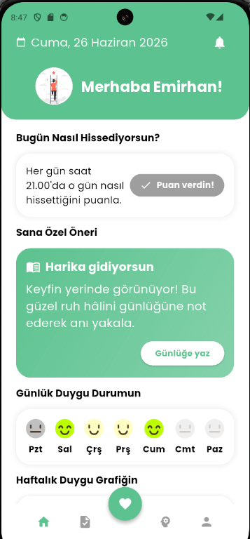
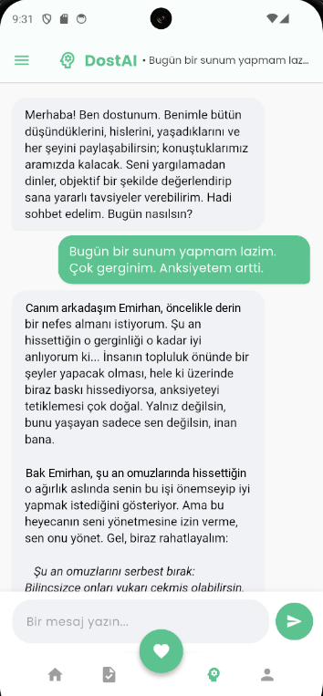
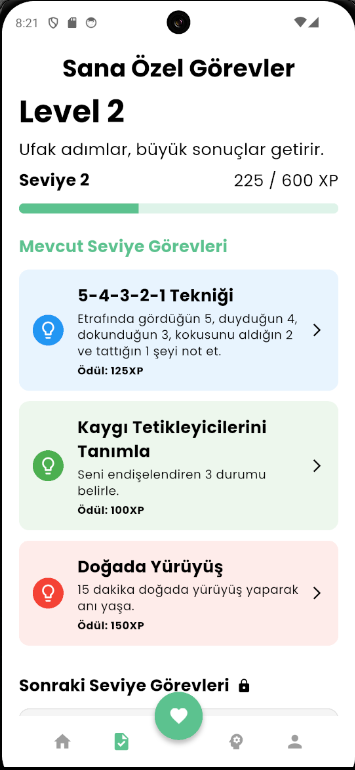
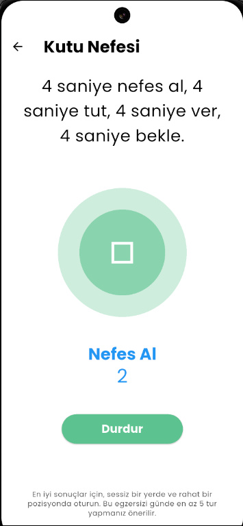

<div align="center">

# ⏸️ Pause

**Kaygı yükseldiğinde, bir mola ver.** · *When anxiety rises, take a pause.*

Sosyal anksiyete için yapay zekâ destekli, kişiselleştirilmiş mobil uygulama<br>
*An AI-assisted, personalized mobile app for social anxiety*

[](#)
[](#)
[](#)
[](#)

### 🌐 [Canlı tanıtım sayfası · Live site](https://emirhan-coban.github.io/pause-landing/)

<br>

&nbsp;
&nbsp;
&nbsp;


</div>

---

## 🇹🇷 Türkçe

**Pause**, TÜBİTAK 2209-A Üniversite Öğrencileri Araştırma Projeleri Destek Programı kapsamında geliştirilen *"Sosyal Anksiyete Yönetimine Yönelik Yapay Zekâ Destekli Mobil Uygulama"* projesidir. Bu depo, projenin **tanıtım sayfasını** içerir.

> 🔒 Uygulamanın kaynak kodu gizli bir depoda tutulur ve **istek üzerine paylaşılabilir**.

### Altı çekirdek modül

| | Modül | Ne yapar |
|---|---|---|
| 📈 | **Ruh hâli takibi** | Beş kademeli günlük puanlama, haftalık grafik, streak ve 7 günlük ortalama |
| 🤖 | **DostAI** | Google Gemini tabanlı, yargılamayan sanal arkadaş; sohbetler kalıcı |
| 📓 | **Duygu günlüğü** | Serbest metinle günlük, geçmiş kayıtlar |
| 🌬️ | **Rahatlatıcı medya** | Nefes egzersizleri (4-7-8, kutu nefesi), doğa sesleri, rehberli meditasyon |
| 🎯 | **Kademeli görevler** | Bilişsel-davranışçı maruz bırakma ilkesiyle 5 seviye, XP ile oyunlaştırma |
| 🔔 | **Hatırlatmalar** | Günde üç yerel bildirim |

Ayrıca kullanıcının ruh hâli ve ilgi alanlarına göre ana sayfayı uyarlayan bir **kişiselleştirme** motoru var.

### Teknik özet

- **İstemci:** Flutter · Dart · Provider · fl_chart · just_audio
- **Mimari:** MVVM yaklaşımında üç katman (sunum / iş mantığı / veri), servis temelli veri erişimi
- **Arka uç:** Firebase Authentication, Cloud Firestore, Realtime Database, Analytics
- **Yapay zekâ:** Google Gemini API (DostAI)
- **Gizlilik:** Kullanıcı verisi uid altında yalıtılır; API anahtarları kaynak kodda tutulmaz

### Pilot sonuçları (N = 15, 2 hafta)

| Modül | Olumlu oran |
|---|---|
| Ruh hâli takibi | %80 (12/15) |
| Duygu günlüğü | %73 (11/15) |
| Görev sistemi | %73 (11/15) |
| DostAI | %60 (9/15) |
| Bildirimler | %60 (9/15) |
| Rahatlatıcı medya | %53 (8/15) |

Genel memnuniyet %73, ortalama tavsiye puanı 7,4/10.

> ⚠️ Bu, küçük örneklemli, kontrol grubu ve klinik ölçek içermeyen, öz-bildirime dayalı **tanımlayıcı bir pilot çalışmadır**. Sonuçlar klinik etkinlik kanıtı değil, öncül bir göstergedir.

---

## 🇬🇧 English

**Pause** is the outcome of the TÜBİTAK 2209-A funded research project *"AI-Assisted Mobile Application for Social Anxiety Management"*. This repository contains the project's **landing page**.

> 🔒 The app's source code lives in a private repository and is **available on request**.

### Six core modules

| | Module | What it does |
|---|---|---|
| 📈 | **Mood tracking** | Five-step daily rating, weekly chart, streaks and a 7-day average |
| 🤖 | **DostAI** | A non-judgmental virtual companion powered by Google Gemini; conversations persist |
| 📓 | **Emotion journal** | Free-text entries and history |
| 🌬️ | **Calming media** | Breathing exercises (4-7-8, box), nature sounds, guided meditation |
| 🎯 | **Graded tasks** | Five levels based on graded exposure from CBT, gamified with XP |
| 🔔 | **Reminders** | Three local notifications per day |

A **personalization** engine adapts the home screen to the user's mood and interests.

### Tech summary

- **Client:** Flutter · Dart · Provider · fl_chart · just_audio
- **Architecture:** three MVVM-style layers (presentation / business logic / data) with service-based data access
- **Backend:** Firebase Authentication, Cloud Firestore, Realtime Database, Analytics
- **AI:** Google Gemini API (DostAI)
- **Privacy:** per-user data isolation under the uid; API keys are kept out of the source code

### Pilot results (N = 15, 2 weeks)

Positive ratings: mood tracking 80%, emotion journal 73%, graded tasks 73%, DostAI 60%, notifications 60%, calming media 53%. Overall satisfaction 73%, mean recommendation score 7.4/10.

> ⚠️ A small, self-reported, **descriptive pilot** with no control group or clinical scale. The numbers are a preliminary signal, not proof of clinical efficacy.

---

## Çalıştırma · Run locally

Saf HTML/CSS/JS, build adımı yok · Plain HTML/CSS/JS, no build step.

```bash
git clone https://github.com/emirhan-coban/pause-landing.git
cd pause-landing
python3 -m http.server 8000   # → http://localhost:8000
```

## Not · Disclaimer

Pause bir araştırma projesidir; tıbbi cihaz değildir ve tanı ya da tedavi yerine geçmez. Zorlandığında bir ruh sağlığı uzmanına başvurman önemlidir.

*Pause is a research project. It is not a medical device and does not replace diagnosis or treatment. If you are struggling, please reach out to a mental-health professional.*
